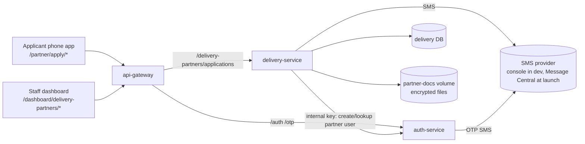
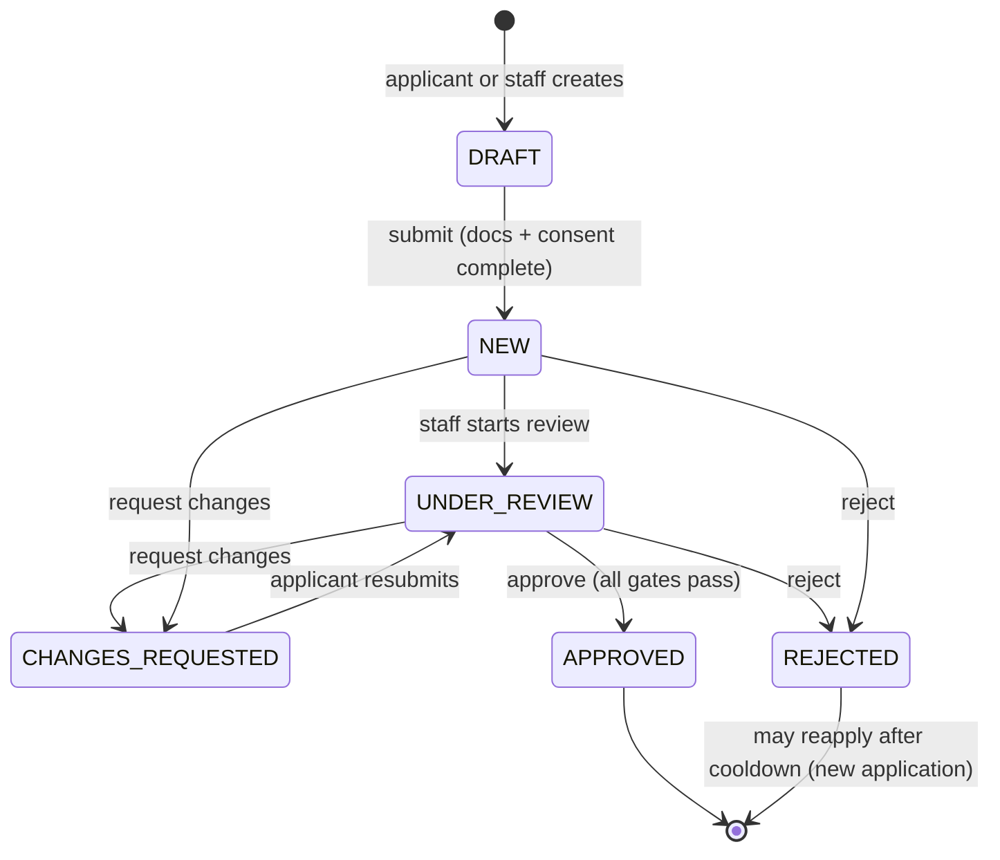
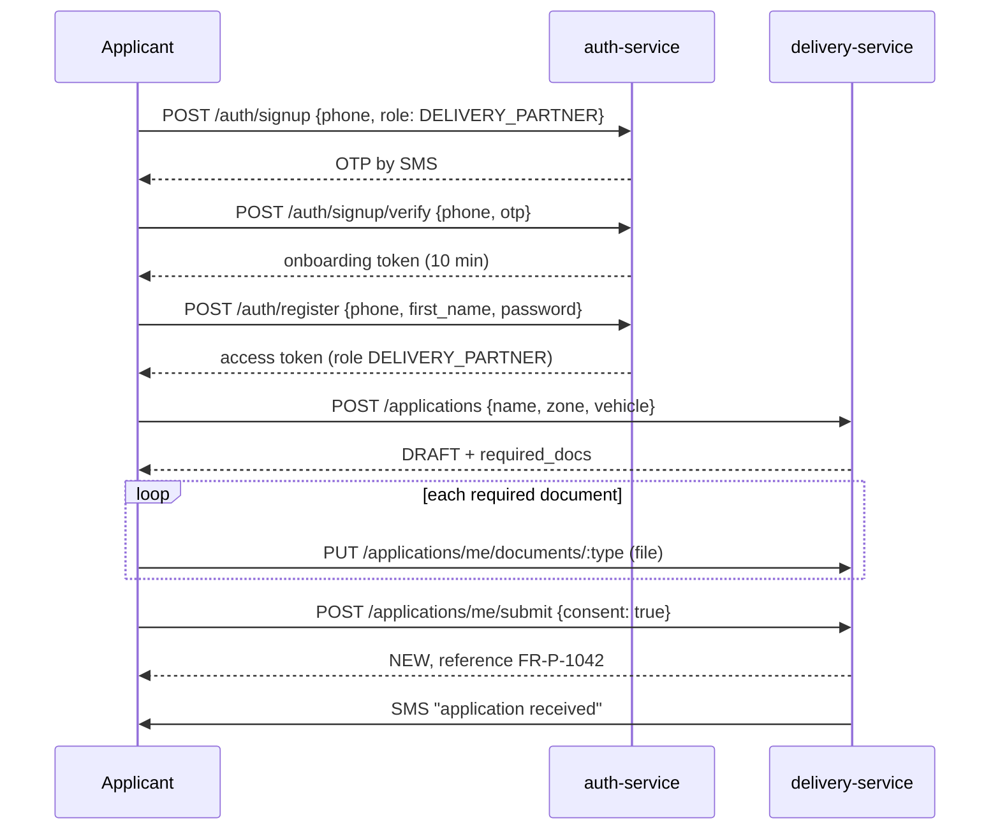
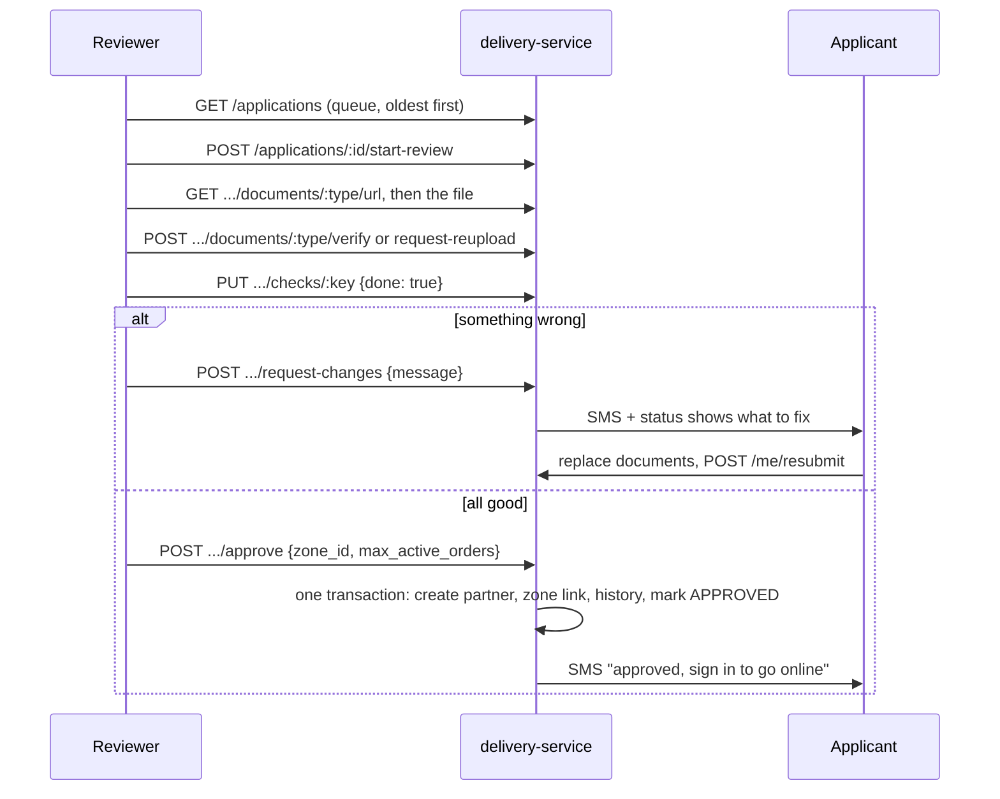
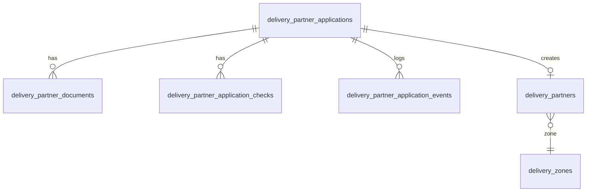

# Delivery partner onboarding — HLD and LLD

Status: Phase 0 and Phase 1 built (see the phase list near the end); everything after that is design only. Date: 2026-10-07. Updated the same day with the SMS decision (D11, §6.8).
Covers `BACKEND_REQUIREMENTS.md` items 19–22 (applications, screening, documents, sign-in and identity link). `GET /summary` here is the application half of item 18; item 23 (go online) builds on the sign-in this design sets up.
Out of scope: partner-side order handling (items 24–28), offboarding, payouts.
Deliberate differences from the item text: document status has no stored `TO_CHECK` (it is `UPLOADED` on a submitted application, §5.1), and the document number is typed in by the applicant and checked by the reviewer, with no OCR "number read from the document" (§9, later).

## 1. Summary

A person applies (alone, or staff add them), uploads documents, and waits. Staff review the documents, tick a screening checklist, then approve, ask for changes or reject. Approval creates the `DeliveryPartner` row and the partner can sign in and go online.

It is built **inside delivery-service** as one new module, on top of the existing `DeliveryPartner`, `DeliveryZone` and auth-service phone-OTP sign-up. No new service, no new queue.

| # | Decision | Choice | Why |
|---|---|---|---|
| D1 | Where it lives | New module `partnerApplication` in delivery-service | The partner row, zones and status history are already there. A new service would need its own database and calls across services. |
| D2 | Applicant identity | Auth-service user with role `DELIVERY_PARTNER` from sign-up | The role already exists in the auth enum. No role switch at approval, so no cross-service step in the approval transaction. |
| D3 | "Is this person an active partner?" | A `delivery_partners` row with status `ACTIVE`, not the role | The role alone is also held by applicants and rejected people. One middleware, `requireActivePartner`, guards operational routes. |
| D4 | Approval | `ADMIN` / `SUPER_ADMIN` only. `OPS_STAFF` does everything except the final approve and reject | Recommended default; confirm (Q3). |
| D5 | Four-eyes | Whoever created an application on someone's behalf cannot approve it | The add-partner screen promises "same rules for everyone". |
| D6 | Files | Private directory on a Docker volume, encrypted at rest, served only through short-lived signed URLs | No object storage exists in the repo. A small `storage` util keeps S3 a later swap. |
| D7 | Upload | `multer` (new dependency, memory storage, 5 MB cap) plus a file-signature check | No upload library exists in any service. |
| D8 | Sensitive numbers | Aadhaar: last 4 digits only. DL and PAN: masked display plus a keyed hash for duplicate detection. No full numbers stored | Smallest exposure that still lets staff catch reused documents. Confirm with legal (Q5). |
| D9 | Events | None in v1. Direct calls | delivery-service has no messaging client today. Add events when something else needs to react. |
| D10 | Background check | A manual tick with a reference note | Vendor integration is a later swap behind the same tick. |
| D11 | SMS | One `sms.send()` with two providers picked by `SMS_PROVIDER`: `console` while building (prints the text, OTP included, to the service log; the service refuses to start with it when `NODE_ENV=production`) and `messagecentral` at launch (its plain SMS API). OTP generation and checking stay in auth-service | Decided by you: no real SMS while building, Message Central at launch. Message Central's VerifyNow is not used because it makes and checks the OTP itself and cannot send our status texts (§6.8). |

## 2. What exists today, and what blocks this

| Finding | Evidence | Effect |
|---|---|---|
| delivery-service `authenticateToken` sets `req.user = decoded.user`, which is `undefined` (auth tokens are flat: `{ user_id, phone, role }`) | `middleware/auth.js`; an ADMIN token on `POST /handle-orders/assignments/assign` returns 401 "Authentication required" | `requireRole` never passes, so the dispatch routes reject everyone. Reviewer ids cannot be read either. |
| `authenticateToken` admits only ADMIN / SUPER_ADMIN / OPS_STAFF | same file | A partner or applicant token is rejected on every route. Widening it blindly would open ~20 staff routes to partners (§9, P0.1). |
| `delivery_partners.user_id` is `UUID`, auth user ids are `BIGINT` | `DeliveryPartner.model.js`, `User.model.js`, token payload | A real user id cannot be stored. The dev table is empty, so the change is safe there. |
| Partner SMS and OTP delivery is not functional | `auth.service.js` calls `emitEvent` / `TOPICS` (lines 98, 155, 806) and neither is imported or defined anywhere in auth-service; `providers/` (imported by `sms.service.js`) does not exist; `notification-service/` is empty | The two sign-up / login OTP sends sit in try/catch, so they fail silently and no SMS goes out; the forgot-password send (line 806) is not wrapped. Every onboarding SMS has the same problem. The fix is decided: console while building, Message Central at launch (D11). Meanwhile, with `NODE_ENV=development` the sign-up, login and forgot-password responses already carry the OTP (`auth.service.js` lines 119, 199, 826), so testing works today without any SMS. |
| `POST /delivery-partners` creates an active partner directly | `deliveryPartner.routes.js` | It bypasses review. It must be closed once onboarding exists. |
| No upload library or file storage in any service | grep across services | Added in this design (D6, D7). |
| No OTP login for a returning user | `/auth/login` reports only `LOGIN` or `SIGNUP`; `verify()` handles only `SIGNUP` and `FORGOT_PASSWORD` | Decided: partners keep phone + password (`/auth/login/password`). OTP is for sign-up and forgot-password only. Fixed 2026-10-08: `/auth/login` used to return nothing (a 500) for an existing unverified user, which is what a staff-created partner is. |

## 3. HLD

### 3.1 Context



The gateway already forwards `/delivery-partners` to delivery-service, so no gateway route is added. Multipart upload through the gateway must be tested (P1.6).

### 3.2 Components

| Component | Responsibility in onboarding |
|---|---|
| auth-service | Phone OTP sign-up, then phone + password login, for applicants. Public sign-up accepts a `role` from an allowlist (`CUSTOMER`, `DELIVERY_PARTNER`). One internal route creates a partner user for staff-created applications. OTP texts go through the same `sms` module as every other text (§6.8). |
| delivery-service `partnerApplication` module | Applications, documents, checks, notes, the event timeline, the approval transaction, the signed-URL file route. |
| delivery-service `deliveryPartner` module | Unchanged owner of the active partner. Gains `application_id`. Direct create is closed. |
| `storage` util | `put(key, buffer)`, `get(key)`, `remove(key)` over the volume, AES-256-GCM per file, key from env. |
| `notify` util | `sms(phone, templateKey, vars)` with the templates in §6.7, sent through the provider in §6.8. |
| Client | Applicant screens `partner/apply/*`, staff screens `PartnerApplicationReview`, `AddDeliveryPartner`, the Applications tab, and the onboarding log on the partner detail page. |

### 3.3 Roles

| Action | Applicant | OPS_STAFF | ADMIN / SUPER_ADMIN |
|---|---|---|---|
| Create, edit and submit own application; upload own documents | yes (own only) | no | no |
| Create an application on someone's behalf; upload for an application | no | yes | yes |
| View queue, detail, documents; add notes | no | yes | yes |
| Start review; verify or reject documents; tick checks; request changes | no | yes | yes |
| Approve; reject | no | no (D4) | yes, but not on an application they created (D5) |

### 3.4 Application lifecycle



`APPROVED` and `REJECTED` are final. A rejected person reapplies as a **new** application after 30 days (constant). A resubmitted application goes back to `UNDER_REVIEW` with the same reviewer, so it does not look untouched in the queue.

### 3.5 Flows

**Self sign-up**



**Review and approval**



**Created on someone's behalf.** Staff submit the form (`POST /applications/on-behalf`). delivery-service asks auth-service (internal key) to create or find the partner user for that phone (role `DELIVERY_PARTNER`, phone not yet verified). The applicant gets an SMS to sign up with that number (OTP, then set a password) and finish any missing documents. The application stays `DRAFT` until they submit, or staff submit it for them once every document is in. The "phone verified" check turns on the first time the applicant signs in (§4.3).

## 4. Review process

### 4.1 Queue

`GET /applications` returns `NEW`, `UNDER_REVIEW` and `CHANGES_REQUESTED` by default, oldest `submitted_at` first. Filters: `status`, `zone_id`, `source`, `search` (name, phone, reference), `page`, `limit`. Each row shows documents as `verified / required`, source (Self or "Admin · name"), and age. The Applications tab and its "waiting for review" and "oldest" numbers (item 18) come from the same table.

### 4.2 Claiming

`start-review` records the reviewer and moves `NEW` to `UNDER_REVIEW`. It is advisory: another staff member sees "Being reviewed by X" and can still act. Two staff cannot override each other's **decisions**, because every decision call carries `expected_version` and a stale one returns 409.

### 4.3 What a reviewer does

1. **Documents.** Open each one (signed URL, 2 minutes, logged as `DOC_VIEWED`). Mark it **Verified** or **Ask to re-upload** with a reason. The licence needs its expiry date entered on verify.
2. **Checks.** Six, ticked one by one with who and when:

| Key | Label | Rule |
|---|---|---|
| `PHONE_OTP` | Phone verified by OTP | Automatic: set the first time the applicant calls the API with a token whose phone matches the application. Tokens are only issued after OTP, so this is proof. |
| `ID_MATCH` | Name and photo match Aadhaar | Can only be ticked when `PHOTO` and `AADHAAR` are both Verified |
| `DL_VALID` | Licence valid for two-wheeler | Needs `DL` Verified with an expiry date in the future. Not required for `CYCLE`. |
| `RC_MATCH` | RC matches vehicle number | Needs `RC` Verified. Not required for `CYCLE`. |
| `BG_CHECK` | Background check cleared | Manual tick; the note holds the report reference (D10) |
| `SAFETY_BRIEFING` | Safety and app briefing done | Manual tick |

   Un-verifying or replacing a document automatically unticks the checks that depend on it.
3. **Notes.** Free-text, staff-only, kept in the timeline.
4. **Decision.**

| Decision | Allowed when | Effect |
|---|---|---|
| Request changes | `NEW` or `UNDER_REVIEW`; message required; lists which documents or fields | → `CHANGES_REQUESTED`; applicant is texted; the status screen shows the message and what to fix |
| Reject | `NEW` or `UNDER_REVIEW`; reason code and note required | → `REJECTED`; applicant is texted; cooldown starts |
| Approve | `UNDER_REVIEW` only, all gates in §4.4 pass | → `APPROVED`; partner created and activated in one transaction |

### 4.4 Approval gates

Approval returns **400 with the full list of what is missing** (so the UI can show it), or 409 on a stale `expected_version`. All of these must hold:

- Every required document is `VERIFIED` (required set: `PHOTO` and `AADHAAR` always; `DL` and `RC` unless the vehicle is `CYCLE`; `PAN` optional).
- Every applicable check is done.
- Licence expiry is in the future (warn the reviewer when under 90 days).
- Vehicle number is not already on another partner (unless `CYCLE`).
- The zone exists and is active.
- Approver is not the application's creator (D5) and is `ADMIN` / `SUPER_ADMIN` (D4).
- No other partner row already uses this `user_id`.

### 4.5 Edge cases

| Case | Handling |
|---|---|
| Applicant replaces a document while `UNDER_REVIEW` | Status of that document goes back to `UPLOADED`, dependent checks untick, a `DOC_UPLOADED` event is logged, the reviewer sees a "changed since you looked" mark. |
| Two reviewers approve at once | Application row is locked (`FOR UPDATE`) inside the approve transaction and the version is checked; the second gets 409. |
| Same Aadhaar, licence or PAN hash on another application | The reviewer sees a warning with the other reference. It does not block; staff decide. |
| Phone already belongs to a customer | Sign-up returns the existing 409. Message: use another number. One role per user is a known limit (Q2). |
| Applicant never finishes a draft | Stays `DRAFT`; it is not in the queue. Cleanup is later. |
| Approved, then the SMS fails | Approval stands. The failure is logged and the status screen still shows the result. |
| Partner later suspended or reactivated | Existing `suspend` / `activate` routes, now writing to `delivery_status_history`. Not part of onboarding. |

## 5. LLD — data

### 5.1 New tables (delivery-service)



**`delivery_partner_applications`**

| Column | Type | Notes |
|---|---|---|
| `id` | UUID PK | |
| `ref_no` | INTEGER, default `nextval('partner_application_ref_seq')` | Shown as `FR-P-` + `ref_no`; sequence starts at 1001 |
| `user_id` | BIGINT, not null | Auth user. One open application per user (partial unique index where status is not `APPROVED` / `REJECTED`) |
| `name`, `phone` | STRING(150), STRING(20) | Phone comes from the token, never from the body |
| `email` | STRING, null | |
| `preferred_zone_id` | INTEGER, null | |
| `vehicle_type` | ENUM `BIKE`, `SCOOTER`, `EV_SCOOTER`, `CYCLE` | |
| `vehicle_number` | STRING, null | Null for `CYCLE` |
| `source` | ENUM `SELF`, `ADMIN` | |
| `created_by` | BIGINT, null | Staff user id when `source = ADMIN` |
| `status` | ENUM from §3.4 | |
| `consent_at` | DATE, null | Background-verification consent |
| `submitted_at`, `reviewer_id`, `review_started_at` | | |
| `decided_at`, `decided_by`, `decision_reason`, `decision_note` | | |
| `partner_id` | UUID, null | Set on approval |
| `version` | INTEGER, default 0 | Optimistic concurrency |
| `created_at`, `updated_at` | | |

**`delivery_partner_documents`** (unique on `application_id` + `type`)

| Column | Type | Notes |
|---|---|---|
| `id`, `application_id` | UUID | |
| `type` | ENUM `PHOTO`, `AADHAAR`, `DL`, `RC`, `PAN` | |
| `status` | ENUM `UPLOADED`, `VERIFIED`, `REJECTED` | "Not uploaded" is the absence of a row. "To check" is `UPLOADED` on a submitted application. This drops item 21's separate `TO_CHECK` value. |
| `file_key`, `mime`, `size_bytes`, `sha256` | | Key is `applications/<id>/<type>-<uuid>.<ext>` |
| `number_masked`, `number_hmac` | STRING, null | Aadhaar: `•••• •••• 4412`. HMAC-SHA256 with `DOC_HASH_KEY` |
| `expiry_date` | DATE, null | Licence only |
| `verified_by`, `verified_at` | | |
| `reject_reason` | TEXT, null | |
| `uploaded_at` | DATE | |

**`delivery_partner_application_checks`** (unique on `application_id` + `check_key`): `check_key` ENUM (§4.3), `done` BOOLEAN, `done_by`, `done_at`, `note`. Rows are created at submit; `PHONE_OTP` starts as not done and flips on first applicant call.

**`delivery_partner_application_events`** (append-only): `id`, `application_id`, `type`, `actor_id`, `actor_role`, `visible_to_applicant` BOOLEAN, `payload` JSONB, `created_at`. Types: `CREATED`, `SUBMITTED`, `DOC_UPLOADED`, `DOC_VIEWED`, `DOC_VERIFIED`, `DOC_REJECTED`, `CHECK_DONE`, `CHECK_UNDONE`, `REVIEW_STARTED`, `NOTE`, `CHANGES_REQUESTED`, `RESUBMITTED`, `APPROVED`, `REJECTED`. This one table feeds the applicant's status timeline and the "Onboarding log" on the partner detail page.

### 5.2 Changes to existing tables

- `delivery_partners.user_id`: `UUID` → `BIGINT` (P0.2).
- `delivery_partners.application_id` UUID, null.
- Migration files follow the existing `YYYYMMDDHHMMSS-description.cjs` style.

### 5.3 Constants (code, not config)

`MAX_FILE_BYTES = 5 MB`, allowed `image/jpeg`, `image/png`, `application/pdf`; `SIGNED_URL_TTL = 120 s`; `REAPPLY_COOLDOWN_DAYS = 30`; `DL_WARN_DAYS = 90`; `max_active_orders` 1–10 (UI offers 2–5, default 3). Move to config-service only if staff need to change them without a deploy.

## 6. LLD — API

All under `/delivery-partners/applications`. Mounted **before** the `/delivery-partners` router in `app.js`, so `applications` is never read as an `:id`. Responses use `ResponseUtil`; failures throw `AppError`; Joi validation returns the full error array (`backend/CLAUDE.md`).

### 6.1 Applicant (role `DELIVERY_PARTNER`; no active partner needed)

| Method and path | Purpose | Notes |
|---|---|---|
| `POST /` | Create my `DRAFT` | Body: `name`, `preferred_zone_id`, `vehicle_type`, `vehicle_number`. 409 if I already have an open one. 403 + cooldown date if rejected recently. |
| `GET /me` | My application | Documents (status, masked number, reject reason), checks as done / not done only, applicant-visible events, `required_docs`. First call sets `PHONE_OTP`. |
| `PATCH /me` | Edit details | Only in `DRAFT` or `CHANGES_REQUESTED` |
| `PUT /me/documents/:type` | Upload or replace | multipart: `file`, optional `number`, `expiry_date`. See §6.5. |
| `DELETE /me/documents/:type` | Remove | `DRAFT` only |
| `POST /me/submit` | `DRAFT` → `NEW` | Needs consent, every required document uploaded. Body: `consent: true` |
| `POST /me/resubmit` | `CHANGES_REQUESTED` → `UNDER_REVIEW` | Needs every `REJECTED` document replaced |

### 6.2 Staff (`ADMIN`, `SUPER_ADMIN`, `OPS_STAFF`)

| Method and path | Purpose | Roles |
|---|---|---|
| `POST /on-behalf` | Create a `DRAFT` for someone | staff |
| `GET /` | Queue (§4.1) | staff |
| `GET /summary` | `{ waiting, oldest_submitted_at, by_status }` for the stat card and sidebar badge (item 18) | staff |
| `GET /:id` | Full detail, notes, all events, duplicate-document warnings | staff |
| `PUT /:id/documents/:type` | Upload on the applicant's behalf | staff |
| `GET /:id/documents/:type/url` | Returns `{ url, expires_at }`, logs `DOC_VIEWED` | staff |
| `POST /:id/start-review` | Claim | staff |
| `POST /:id/documents/:type/verify` | Body: `expiry_date` (required for `DL`) | staff |
| `POST /:id/documents/:type/request-reupload` | Body: `reason` | staff |
| `PUT /:id/checks/:key` | Body: `done`, `note` | staff |
| `POST /:id/notes` | Body: `text` | staff |
| `POST /:id/submit` | Submit a staff-created draft once complete | staff |
| `POST /:id/request-changes` | Body: `message`, `items[]`, `expected_version` | staff |
| `POST /:id/reject` | Body: `reason_code`, `note`, `expected_version` | ADMIN / SUPER_ADMIN |
| `POST /:id/approve` | Body: `zone_id`, `max_active_orders`, `note`, `expected_version` | ADMIN / SUPER_ADMIN |

Also: `GET /delivery-partners/:id/onboarding` (staff) returns the linked application's events and masked document list for the partner detail page. Registered above the open `GET /:id`.

### 6.3 File route (no bearer token)

`GET /files/:token` where `token` is a JWT signed with the service secret, 120 seconds, carrying the document id. It streams the decrypted file with `Content-Type` from the stored mime, `Content-Disposition: inline; filename="document.<ext>"` (a fixed name, never the applicant's), `X-Content-Type-Options: nosniff`, `Cache-Control: no-store`. Works in an `` or `<iframe>`. An expired or tampered token returns 401.

### 6.4 auth-service changes

- `POST /auth/signup` accepts optional `role`, allowlist `CUSTOMER` and `DELIVERY_PARTNER`. Anything else is 400. Staff roles can never come from this public route. A registered number keeps its one role: signing up with a different role (default `CUSTOMER`) returns 409, so a customer cannot become a delivery partner and the reverse (done 2026-10-08).
- `POST /internal/partners` (header `x-internal-key` = `INTERNAL_API_KEY`; auth-service root path, not under `/auth`, and not in the gateway config, so it is only reachable from sibling services): body `{ phone, name }`, finds or creates the user with role `DELIVERY_PARTNER`, phone unverified, returns `{ user_id }`. Idempotent by phone. If the phone is a customer or staff user it returns 409 (the same one-role rule as `/auth/signup`). **Built 2026-10-08.** Key unset = 503, missing or wrong key = 401.
- Login stays phone + password (`/auth/login`, then `/auth/login/password`). No OTP login. `/auth/login` returns `SIGNUP` for a number with no account, an unverified one (a staff-created partner) or a verified one that never finished its profile; sign-up re-sends the OTP and `verify` issues a fresh onboarding token for `/auth/register`. `register` acts only on the token's own account and needs a verified phone (done 2026-10-08).

### 6.5 Upload rules

Checked in this order: caller owns the application (or is staff) → application status allows edits → `type` valid for this vehicle (no `DL` / `RC` for `CYCLE`) → size ≤ 5 MB → declared mime allowed → **file signature** matches (`FFD8FF` jpeg, `89504E47` png, `25504446` pdf) → write encrypted → upsert row, delete the old file after the row commits. Uploading over a `VERIFIED` document resets it to `UPLOADED` and unticks dependent checks.

### 6.6 Approval transaction

```
approve(id, input, actor):
  tx = await sequelize.transaction(async (t) => {
    app = Application.findByPk(id, { lock: t.LOCK.UPDATE, transaction: t })
    assert app.version == input.expected_version        // else 409
    assert actor.role in [ADMIN, SUPER_ADMIN]            // else 403
    assert !(app.source == ADMIN && app.created_by == actor.user_id)   // else 403
    gaps = missingDocs(app) + missingChecks(app) + licenceExpired(app) + vehicleTaken(app) + zoneInactive(input.zone_id)
    if gaps.length -> throw AppError("Cannot approve", 400, gaps)
    partner = DeliveryPartner.create({ user_id, name, phone, vehicle_type, vehicle_number,
                                       zone_id: input.zone_id, max_active_orders, status: ACTIVE,
                                       application_id: app.id, joined_at: now }, { transaction: t })
    DeliveryPartnerZone.create({ delivery_partner_id: partner.id, zone_id: input.zone_id }, { transaction: t })
    DeliveryStatusHistory.create({ delivery_partner_id: partner.id, status: "ACTIVE", remarks: "Approved" }, { transaction: t })
    app.update({ status: APPROVED, partner_id: partner.id, decided_by, decided_at, version: version + 1 }, { transaction: t })
    Event.create({ type: APPROVED, ... }, { transaction: t })
    return partner
  })
  notify.sms(app.phone, "approved")      // after commit; failure is logged, not thrown
```

The `delivery_partners.user_id` unique constraint is the last line of defence against a double approval.

### 6.7 SMS templates

| Key | When | Text (draft) |
|---|---|---|
| `received` | submit | "Freshly: we got your partner application FR-P-{ref}. We'll text you within 1–2 working days." |
| `invite` | created on behalf | "Freshly: {name}, you've been added as a delivery partner. Sign up with this number to finish your application: {link}" |
| `changes` | request changes | "Freshly: we need a few changes to FR-P-{ref}. Open the app to see what." |
| `reupload` | request re-upload | same as `changes` with the document name |
| `approved` | approve | "Freshly: you're approved, {name}! Sign in to go online." |
| `rejected` | reject | "Freshly: we couldn't approve FR-P-{ref}. You can apply again after {date}." |

Before launch every text above must be registered as a DLT template (template id, entity id, sender id) and sent word for word. `{name}`, `{ref}`, `{date}` and `{link}` are the variable slots. Add the OTP text to the same registration. While building, the rendered text is printed instead (§6.8).

### 6.8 SMS providers

Both services carry the same small module. In auth-service it replaces the missing `providers/` folder that `sms.service.js` imports.

```
src/utils/sms/index.js                    send({ to, text, kind })  — picks the provider once at startup
src/utils/sms/console.provider.js         logs the text, no network
src/utils/sms/messagecentral.provider.js  real SMS
```

- **Choosing.** `SMS_PROVIDER` is `console` or `messagecentral`. Unset means `console` outside production and a startup error in production. `console` with `NODE_ENV=production` is a startup error, so an OTP can never land in a production log.
- **Console provider.** It writes through the service's winston `logger`, not `console.log` (`backend/CLAUDE.md`), at info level, for example `[sms:console] to=+91… kind=OTP text="Your Freshly code is 482913"`. This is the one place an OTP is logged. Every text, OTP or status, goes through it, so development shows the whole flow.
- **`kind`** is `OTP` or `TRANSACTION`. The Message Central provider sends it as `messageType`.
- **Message Central provider.** These details come from their public docs. Check them against your account before building.
  1. Token: `GET https://cpaas.messagecentral.com/auth/v1/authentication/token` with `customerId`, `key` (the account password, Base64-encoded), `scope=NEW`, `country=91`. Keep the token in memory and fetch a new one on a 401. The docs I read do not state its lifetime.
  2. Send: `POST /verification/v3/send` with header `authToken` and `countryCode=91`, `mobileNumber`, `flowType=SMS`, `type=SMS`, `senderId`, `message`, `messageType`, plus `templateId` and `entityId` when the template is not registered with Message Central.
  3. Environment: `MC_CUSTOMER_ID`, `MC_PASSWORD_B64`, `MC_SENDER_ID`, `MC_ENTITY_ID` and one template id per text (`MC_TEMPLATE_OTP`, `MC_TEMPLATE_RECEIVED`, …).
- **Failure.** Log and return. Never throw out of a request, because a failed text must not undo an approval. This is how the current try/catch already behaves.
- **Not used: VerifyNow** (`/verification/v3/validateOtp`). It makes the OTP itself, accepts no custom code or text, and is checked through a `verificationId`. Using it would replace the existing local OTP check in sign-up, login, resend and forgot-password, and the six status texts would still need the plain SMS API. Revisit only if DLT registration turns out to be blocked (Q8, Q9).
- **Why one interface.** OTP and status texts take the same path, so development prints both and launch sends both.

### 6.9 Errors

400 validation or approval gaps (with a `gaps` array) · 401 no or bad token · 403 wrong role, own-application approval, recent rejection · 404 not found (also returned for another applicant's id, so ids do not leak) · 409 open application exists, stale version, duplicate vehicle · 413 file over 5 MB · 415 wrong file type.

## 7. LLD — code layout (delivery-service)

Follows `backend/CLAUDE.md` exactly: controller → service → repository → model; `AppError`; `ResponseUtil`.

```
src/models/            PartnerApplication.model.js, PartnerDocument.model.js,
                       PartnerApplicationCheck.model.js, PartnerApplicationEvent.model.js
src/modules/partnerApplication/
                       partnerApplication.routes.js | .controller.js | .service.js
                       partnerApplicationRules.js     (required docs, checks, gates, transitions: pure functions)
src/modules/repository/ partnerApplication.repository.js, partnerDocument.repository.js, ...
src/middleware/        auth.js (split, see P0.1), upload.js (multer config + signature check)
src/utils/             storage.js (encrypted volume), notify.js
src/constants/         roles.js (mirrors inventory-service/src/constants/roles.js)
migrations/            one per table group + the user_id type change
```

`partnerApplicationRules.js` holds every rule as a pure function (`requiredDocs(vehicleType)`, `approvalGaps(app)`, `canTransition(from, to, role)`), so the state machine and the gates can be tested without a database.

## 8. Client wiring

| Screen | Change |
|---|---|
| `partner/apply/Apply.jsx` | Add the OTP step (reuse `CodeInput` from `Login.jsx`): sign-up with `role`, verify, set a password (`/auth/register`), then `POST /applications`. Vehicle type `Cycle` hides the vehicle number. |
| `partner/apply/Documents.jsx` | Render `required_docs` from the server (cycle: photo + Aadhaar only). Upload each file as chosen; show verified / rejected state per document. Submit sends consent. |
| `partner/apply/Status.jsx` | `GET /me`: timeline from applicant-visible events; banner for `CHANGES_REQUESTED` with the message and a link to the failing documents; a final screen for `REJECTED` with the reapply date. |
| `partner/Login.jsx` | After sign-in: active partner → `/partner/home`; otherwise → `/partner/apply/status` or `/partner/apply`. **DONE 2026-10-10:** phone + password; a non-partner role is refused; APPROVED or no application (staff-created) → `/partner/home`, any other status → `/partner/apply/status`. `App.jsx` wraps every `/partner/*` screen except `login` and `apply` in `RequirePartner` (needs a `DELIVERY_PARTNER` token); the Profile "Log out" revokes the session and clears the token. **Desktop workspace removed 2026-10-15:** the partner app is phone-only (a desktop browser shows the same 430 px column); `RequirePartner` sends everyone to `/partner/login`. Sign-in and sign-out live in `lib/partnerSession.js` (`signInPartner`, `signOutPartner`). |
| `dashboard/DeliveryPartners.jsx` (Applications tab, stat cards) | Real queue and `GET /summary`. |
| `dashboard/PartnerApplicationReview.jsx` | Everything in §4: signed-URL preview, verify / re-upload, ticks, notes, three decision buttons; approve button disabled until the gaps list is empty, and shows the list from the 400 if it still fails. |
| `dashboard/AddDeliveryPartner.jsx` | `POST /on-behalf`, then uploads. |
| `dashboard/DeliveryPartnerDetail.jsx` | Onboarding log and masked documents from `/onboarding` (replaces `ONBOARDING_LOG` and `PARTNER_DOCS` demo data). |

## 9. Build order

**Phase 0 — blockers (found in the code, must come first)**

| # | Work |
|---|---|
| P0.1 | **DONE 2026-10-07.** delivery-service auth: `req.user = decoded` (full payload). `authenticateToken` keeps its name and now admits any valid token that has a role; `requireRole(STAFF_ROLES)` is the second door on all 21 routes that use it, across the deliveryPartner, deliveryZone, deliveryPartnerZone, delivery and handleOrder modules. `DELIVERY_PARTNER` is in the new `src/constants/roles.js` (the gateway checks no roles, so it needs no change). The dispatch routes work again. Checked by `delivery-service/auth.check.js`. **Differs from the plan:** the two `partner/handover/.../confirm-*` routes are staff-only for now, not `requireActivePartner`, because that guard needs P0.2 first. P0.2 is done, but do not just swap the guard: (1) nothing checks that the caller is the handover's old partner (confirm-handover) or new partner (confirm-receipt), so any active partner could confirm anyone's handover; (2) the order service lets only ADMIN, SUPER_ADMIN and SUPPORT read or change an order (a partner, OPS_STAFF and the SYSTEM token all get 403), so a partner's token fails at the order step; (3) both service methods have bugs of their own (un-awaited transaction, work done outside it). See Task 58 in `task_Logger.md`. |
| P0.2 | **DONE 2026-10-07 (migration written and applied to dev only).** `20261007010000-change-delivery-user-ids-to-bigint.cjs` changes `delivery_partners.user_id`, `delivery_assignments.assigned_by` and `delivery_assignment_history.changed_by` from UUID to BIGINT in one transaction. It refuses to run if any of the three holds a value, because a UUID has no BIGINT equivalent. You confirmed production is empty; it was not checked. The model and the two `assigned_by` validators now match. `requireActivePartner` on the two `confirm-*` routes is unblocked. |
| P0.3 | **DONE 2026-10-08 for auth-service; delivery-service copy not added yet.** `src/utils/sms/` (`index.js`, `console.provider.js`) in auth-service; `sms.service.js` now calls it (the `GetProvider` import is gone) and `sendOtp` is called from the four places that should send an OTP: sign-up (new user and re-sign-up), forgot-password and resend. The old `emitEvent` / `TOPICS` calls are removed. `SMS_PROVIDER` is `console` by default; auth-service refuses to start with `console` and `NODE_ENV=production`, so **do not deploy auth-service to production until the Message Central provider exists** (it would not start). Checked on dev: each path writes `[sms:console] to=… kind=OTP text="Your Freshly code is …"` to the log with the same code the API returned, and an unknown phone sends nothing. **delivery-service:** copied in Phase 1 (the `received` text needs it), with the same `env.js` guard, so delivery-service also refuses to start in production with `console` until the Message Central provider exists. The Message Central provider and DLT registration are launch work, not Phase 0. |
| P0.4 | Keep password login (decided); **DONE 2026-10-08:** `/auth/login` no longer 500s for an unverified user, and `register` is bound to the token's user. The `role` allowlist on `/auth/signup` is **DONE 2026-10-08** (one role per number). **DONE 2026-10-08:** `INTERNAL_API_KEY` and `POST /internal/partners` (auth-service). The delivery-service caller is built in Phase 1/3. |
| P0.5 | **DONE 2026-10-08.** `POST /delivery-partners` is SUPER_ADMIN only: `requireRole([ROLES.SUPER_ADMIN])` in `deliveryPartner.routes.js` (it was passed a string, so it returned 403 to everyone). Not yet tested with a live token. |

**Phase 1 — applicant path.** Four tables and models, storage util, upload middleware, applicant endpoints, checks seeded at submit, `received` SMS, client Apply / Documents / Status. Exit: a real sign-up reaches `NEW`.

**Phase 1 status: DONE 2026-10-08 (uncommitted).** Exit met on dev through the real UI: sign-up with role `DELIVERY_PARTNER` → OTP → register → application → four uploads → submit → `NEW`, `FR-P-1001`, only `PHONE_OTP` ticked, `received` text in the delivery-service log. Checks: `partnerApplicationRules.check.js`, `storage.check.js`, `partnerApplication.check.js` (live), `auth.check.js`. Where it differs from the plan above:
- `PHONE_OTP` is ticked at submit when the token's phone equals the application's phone (the token only exists after the OTP passed), not by a separate OTP call.
- Uploads are accepted in `DRAFT` and `CHANGES_REQUESTED` only; a document can be deleted in `DRAFT` only. Uploads while `UNDER_REVIEW` and un-ticking dependent checks on replace belong to Phase 2.
- **Row lock (2026-10-11):** `putDocument` re-reads the application with `SELECT … FOR UPDATE` inside its transaction and judges editable / allowed-type on that locked row, so an applicant upload and a reviewer decision serialize. **Phase 2 rule:** every reviewer write (claim, verify, check, decision, approve) must take the same application-row lock first, then touch documents (lock order: application → documents). `updateMine` and `deleteDocument` take the same lock. **Version (2026-10-11):** every applicant write (`updateMine`, `putDocument`, `deleteDocument`, and the `submit` / `resubmit` status moves through `transition()`) adds 1 to `version` inside the locked transaction; refused or rolled-back writes do not. Phase 2: the staff detail must return `version`, and every reviewer decision compares it with `expected_version` under the lock, then bumps it. Open point for Phase 2: whether `start-review` (advisory claim) should bump it, since a bump makes every other reviewer's open screen stale.
- **Unique plate (2026-10-11):** `20261011000000-make-delivery-partner-vehicle-number-unique.cjs` adds `UNIQUE (vehicle_number)` on `delivery_partners` (NULL repeats, so cycles are fine). Plates are compared exactly: the application stores trim + upper case but keeps inner spaces, so `PB 65 AX 4412` and `PB65AX4412` are different values. Phase 2 approval: catch the unique violation and answer 409 "vehicle already registered" (the global handler's generic "Resource already exists" is too vague for the reviewer), and decide whether to normalize spaces before comparing.
- `application_id` on `delivery_partners` is deferred to Phase 2 (it is written at approval).
- The `received` text uses a hyphen ("1-2 working days") so it stays plain GSM text; the DLT template must match it exactly.
- delivery-service needs two more env values, `STORAGE_KEY` (64 hex) and `DOC_HASH_KEY` (32+ chars), and a Docker volume `partner_docs` for the encrypted files.
- Client: the sign-up, OTP, register and create-application calls run from one Apply screen, and a retry skips the steps that already succeeded (an OTP is single use). Not built on the client yet: editing details (vehicle, zone) after the application exists, removing a document, and re-applying after a rejection. A signed-in applicant with no application (registered but the create call never ran) has no way to create one: Apply would try a second sign-up. `Login.jsx` was wired afterwards (see its row in the client table). `/auth/register` returns no access token, so the client uses the 10-minute onboarding token and then the refresh cookie.

**Phase 2 — review path.** Queue, detail, claim, verify / re-upload, checks with dependency rules, notes, three decisions, the approval transaction, signed-URL file route, staff review screen. Exit: an application goes from `NEW` to an `ACTIVE` partner who shows in `GET /delivery-partners/list`.

**Phase 2 status: DONE 2026-10-12 (uncommitted).** Exit met on dev through the real UI: a phone applicant at `NEW` → staff opened the queue, claimed it, opened and verified every document, ticked the checks → Approve with zone and order cap → `ACTIVE` partner in the Partners tab (Mohali East Zone, 0 / 3). Also run in the browser: Request changes and Re-upload loops from both sides (dashboard and 390 px phone), Reject with the `OTHER` 10-character rule, the ops view (no Approve / Reject), and a stale-version 409 that kept the dialog input. Checks: `partnerReview.check.js` (live, 378 assertions, six clean runs in a row), `partnerApplication.check.js`, `partnerApplicationRules.check.js`, `auth.check.js`. Migration: `20261012000000-partner-review-path.cjs`. Where it differs from the plan above:
- **P2-1:** a re-upload request marks the document `REJECTED` and moves the application to `CHANGES_REQUESTED` (§4.5 kept it `UNDER_REVIEW`). The phone upload rule needed no change.
- **P2-3:** `CHANGES_REQUESTED → REJECTED` is allowed, only with reason `NO_RESPONSE`; any other code returns 400. This extends the §4.3 decision table.
- **P2-8:** the signed file URL is a stateless JWT (audience `partner-file`) that works any number of times for 120 s and then returns 401. No bearer header on the route; CORP is `cross-origin`, `X-Frame-Options` is removed and CSP is `frame-ancestors <ALLOWED_ORIGINS>` so the dashboard can embed it. `Content-Disposition` is `inline; filename="document.<ext>"`, never the applicant's name.
- **P2-10:** resubmit is blocked only by rejected *required* documents; a rejected optional one (PAN) does not block it. The phone Documents screen uses the same rule.
- Request changes sets each flagged document to `REJECTED` with `reject_reason` = the message, so the applicant sees what to fix on the document itself.
- Approve requires `max_active_orders` (1–10, `MAX_ORDERS` in `partnerApplicationRules.js`) and `zone_id`; the note is optional. Reject requires a reason code and a note of 3+ characters (10+ for `OTHER`). Neither reaches the applicant.
- Approve takes the application lock, then a plate lock, then re-reads documents and checks inside the transaction, and runs every check before the first insert. Cycles store no plate. `application_id` on `delivery_partners` is now written at approval.
- Every staff write returns the full fresh detail (`version`, `can_verify`, `can_tick`, `blocked_by`, `gaps`, `warnings`, `can_decide`). Notes and document views do not bump `version`; verify, re-upload, tick and untick do.
- **Known gap — details editing on the phone:** no applicant screen edits name, email, preferred zone or vehicle number (`PATCH /me` exists on the server but the client never calls it, and Apply redirects existing applicants). The staff Request changes dialog still offers those four as items, so such a request cannot be fixed in the app today. Fix with a small "Your details" form on the Documents screen, or drop the four items from the dialog until then.
- Not run in a browser: the preview link expiring on an open tab after 120 s (covered by the check), and a stale-version 409 between two real browsers (simulated with a direct API call).
- Not in Phase 2: reviewer names (the screen shows "you" or "staff #id", P2-4), the summary counts above the Partners tabs (still demo data), and the "View partner" link, which opens the existing demo profile page.

**Phase 3 — completeness.** On-behalf creation and invite SMS, `GET /summary` wired into the stat cards and sidebar badge, `/onboarding` on the detail page, duplicate-document warnings.

**Phase 3 status: DONE 2026-10-15 (uncommitted).** Exit met on dev through the real UI and the real auth-service: staff add a partner for a phone → the invite text is in the delivery-service log → staff upload five documents and submit with the attestation → the invitee signs up from the link on a 390 px phone (real OTP, no forged token) → a second admin approves from the screen → `ACTIVE` partner in the Partners tab, and the partner page shows the real onboarding record. Browser walk-through: 22 steps, two admins and two 390 px phone sessions, no console errors beyond the expected 401 of an unfinished-account login. Checks: new `authClient.check.js` (pure) and `partnerOnBehalf.check.js` (live); extended `partnerApplicationRules.check.js` and `partnerReview.check.js`; rerun and green: `partnerApplication`, `auth` (22 routes x 7 probes), `storage`, and auth-service `accountState`, `internalKey`, `passwordReset`, `signupRole`. Migration: `20261013000000-partner-phase3.cjs` (partial index on `delivery_partner_documents (type, number_hmac)`). Decisions, as built:
- **P3-1** staff attest consent on submit (`consent_attested`, stored in the `SUBMITTED` payload with the staff id). **P3-2** the Add form only creates the draft; uploads and Submit are on the review screen in a Draft mode. **P3-3** the only extra is the phone "Your details" form.
- **P3-4** staff upload and submit only when `source = ADMIN` and the status is `DRAFT`. **P3-5** `waiting` = `NEW` + `UNDER_REVIEW`. **P3-10** drafts show only under a "Draft" status filter, not in the queue or the badge.
- **P3-6** `PHONE_OTP` is ticked on the invitee's first `GET /me` whose token phone equals the application's phone; nobody ticks it by hand, so an invitee who never signs up cannot be approved. The creator of an `ADMIN` application cannot approve it (D5); another admin can.
- **P3-7** no invite text when the number already has a working account (`invite_sent: false`; the screen says so). **P3-9** the link is `PARTNER_APP_URL` + `/partner/apply?phone=<10 digits>`; `PARTNER_APP_URL`, `INTERNAL_API_KEY` and `AUTH_SERVICE_URL` are now declared in delivery-service `env.js`.
- **P3-8** a duplicate warning matches type + `number_hmac` on another user, any status; it never blocks, shows to every staff role, and is capped at 5 per document. **P3-11** create order: validate, auth-service call, database checks, insert. **P3-12** no new event types: `CREATED`, `DOC_UPLOADED`, `SUBMITTED`, `CHECK_DONE` carry `payload.on_behalf`.
- Where it differs from the plan: the partner id in `GET /delivery-partners/:id/onboarding` is a UUID. `GET /summary` is registered above `GET /:id`.
- **Fixes found on the way (in scope because the exit test needs them):** (1) the invitee's sign-up hit a 409 because the staff draft already existed; `Apply` now reads the existing application first and adopts it (`loadMine`). (2) Password login for a number staff added but nobody signed up (no `password_hash`) returned 500; it is now 401 "Finish sign-up first", and both partner login pages show a "Finish sign-up" link. (3) **`axiosInstance` treated every 401 as an expired session, including a login's own.** A wrong password therefore showed the refresh call's 400 instead of the server's message. Login requests (`/auth/login*`) now skip the refresh, so every login screen shows the real message ("Invalid credentials", locked, "Finish sign-up first"). This is a shared file and changes the message for all logins. (4) `PATCH /me` is now used: the phone Documents screen has a "Your details" card (name, email, zone, vehicle number; vehicle type is read-only after applying, P2-5; fields named in the latest "changes requested" are outlined). This closes the Phase 2 "details editing" gap.
- **Live now:** the Waiting for review card, the sidebar badge (60 s refetch, "99+" over 99, a dot when collapsed) and the overview tile come from `GET /summary`; the partner detail page shows the real profile, zone, documents (masked) and onboarding record, and no longer falls back to the demo partner "Ravi Kumar". `ONBOARDING_LOG`, `PARTNERS`, `ZONES` and the `NEEDS_ATTENTION_DEMO.partnerApplications` sample are removed.
- **Not run through the UI:** in the walk-through the reviewer's document verification and the six check ticks were sent as the same API calls the buttons make (their buttons were browser-tested in Phase 2); approval was clicked. The document preview does not render in the walk-through because the test files are not real images. Duplicate warnings and the OPS view are covered by `partnerOnBehalf.check.js` and `partnerReview.check.js`, not by the browser.
- **Known limits, not built:** resend invite; cancel or withdraw a draft (a mistyped number sends the invite to a stranger and leaves a stuck draft and an unverified account on that number); Message Central and DLT for the invite (the text is over 160 characters, so two SMS segments); the Active, Online and Suspended cards on the Partners page are still sample data; reviewer names (`staff #id`, P2-4); `GET /delivery-partners/:id` is public and exposes `application_id` and location (existing, untouched). The auth-service allows 100 requests per 15 minutes per IP, so repeated browser runs on one machine hit 429; restarting the container clears it.

**Before launch (not before development):** the `messagecentral` provider, DLT entity, sender and template approval, and `SMS_PROVIDER=messagecentral` in the production environment.

**Later, not designed here:** OCR of document numbers (item 21's "number read from the document"), a background-check vendor, licence-expiry reminders for active partners, applicant withdrawal, reviewer reassignment, S3 storage, users with more than one role.

## 10. Test plan

| Area | Cases |
|---|---|
| Rules (pure, no DB) | Every legal and illegal transition per role; required docs and checks per vehicle type; dependency unticking; licence expiry gate; `approvalGaps` lists every missing item. |
| Auth | No token 401; customer 403 on every route; applicant cannot read another applicant's id (404); applicant cannot call staff routes; OPS_STAFF cannot approve or reject; creator cannot approve own on-behalf application; applicant with no active partner is rejected by `requireActivePartner`. |
| Upload | 5 MB passes, 5 MB + 1 byte is 413; `.exe` renamed to `.jpg` fails the signature check; PDF passes; replacing a verified document resets it. |
| Privacy | The stored file on disk is not readable as an image; signed URL works any number of times within 120 s and fails after (P2-8); `GET /me` never returns internal notes or `number_hmac`; logged-out partner reads show no name or phone (as in item 17). |
| Concurrency | Two simultaneous approvals: one 201, one 409; no duplicate partner. |
| SMS | `SMS_PROVIDER=console` prints the rendered text for every template. Both services refuse to start with `console` and `NODE_ENV=production`. The Message Central provider is tested against a mocked HTTP server (token fetch, refresh on 401, the fields sent). One live send to a test number before launch. |
| End to end | Sign-up → upload → submit → start review → verify → tick → approve → partner appears in the list with zone, then signs in; plus the changes-requested loop and a rejection with cooldown. |

## 11. Open questions

| # | Question | Default if unanswered |
|---|---|---|
| Q1 | Which SMS vendor? | Answered: console while building, Message Central at launch (D11) |
| Q2 | May an existing customer's phone become a partner? Users have a single role. | No: they must use another number |
| Q3 | Can `OPS_STAFF` approve and reject, or only prepare? | Prepare only (D4) |
| Q4 | Where do files live: the server's Docker volume, or S3? | Docker volume (D6) |
| Q5 | Is storing the last 4 digits of Aadhaar and a masked licence number acceptable for your compliance needs? | Yes, with legal review before launch |
| Q6 | Reapply cooldown after rejection | 30 days |
| Q7 | Is a manual background-check tick enough to launch? | Yes (D10) |
| Q8 | Do you already have a DLT entity id, sender id and approved templates for Message Central? | Blocks launch, not development. No default |
| Q9 | Does your Message Central plan include the plain SMS API (Message Now), not only VerifyNow? | Check before launch. If not, VerifyNow replaces the local OTP check (§6.8) |
